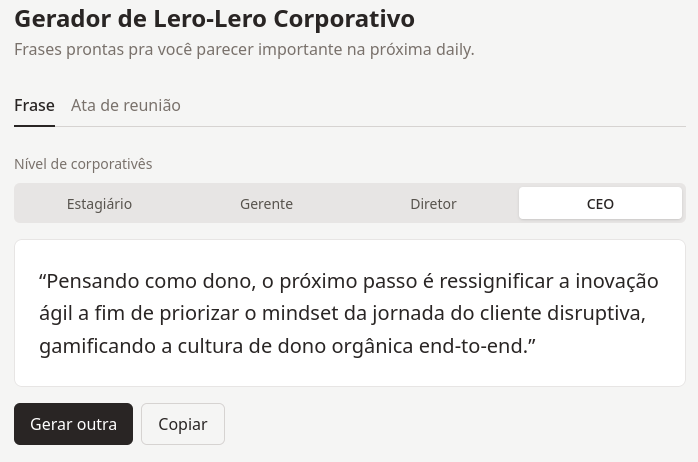
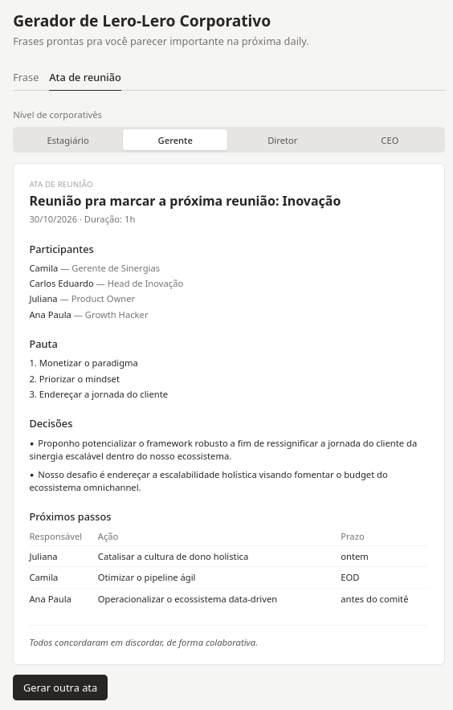

# Gerador de Lero-Lero Corporativo

Gerador de frases corporativas sem sentido nenhum, feito com Vue 3 e Tailwind.



## Funcionalidades

- Gera frases aleatórias em corporativês
- 4 níveis de intensidade: Estagiário, Gerente, Diretor e CEO
- Botão pra copiar a frase
- Gera uma ata de reunião falsa, com participantes, pauta, decisões e próximos passos



## Rodando localmente

```bash
npm install
npm run dev
```

## Adicionando palavras

As listas de palavras ficam em `src/generator.js`. Os substantivos precisam ter o artigo (`o paradigma`, `a sinergia`) e os adjetivos ficam como `['masculino', 'feminino']`, senão a concordância quebra.

## Stack

- Vue 3 com `<script setup>`
- Vite
- Tailwind CSS v4
